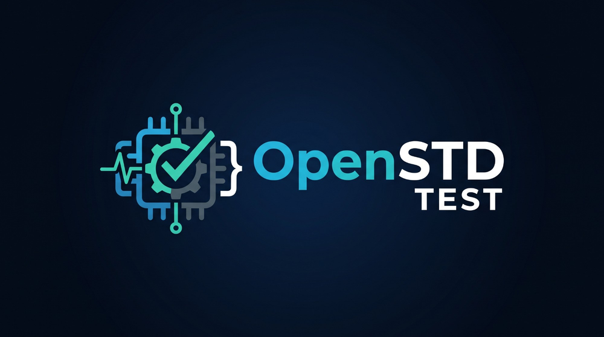

<p align="center"></p>

<p align="center">
  <a href="../../actions/workflows/ci.yml"></a>
  
  
  <a href="https://delacruz200.gumroad.com/l/openstd-pro"></a>
  <a href="#colaborar-con-el-proyecto"></a>
</p>

Diagnóstico de PC para Windows y Linux: prueba el hardware y el sistema, da un veredicto claro
(**PASA / FALLA / NO EVALUADO**), arma un reporte PDF y lo manda por correo a la dirección que vos configures.

Pensado para talleres y técnicos: botones grandes, explicaciones en palabras simples y un "qué hacer" concreto
para cada problema. Corre desde un pendrive, sin instalar nada en la PC del cliente.

*English: PC diagnostics for Windows and Linux (CPU, RAM, disks, battery, GPU and OS error logs) with a PDF
report sent by email. Local web panel, no installation needed. The interface is in Spanish.*

> ⭐ **¿Querés ahorrarte la preparación?** La [**versión Pro**](https://delacruz200.gumroad.com/l/openstd-pro) trae el
> pendrive listo para usar sin internet (Python y librerías incluidos), una guía de diagnóstico en PDF con checklists
> para imprimir y soporte por mail. Las próximas funciones (Reparar Windows, Monitor de juegos y Monitor de red)
> llegan gratis a quienes la compran. Comprándola también ayudás a que este proyecto siga siendo libre.

## Qué prueba

| Prueba | Cómo | Da FALLA si… |
|---|---|---|
| **Sistema operativo** | Registro de eventos de Windows o del kernel de Linux, desde una fecha de referencia | Hay pantallazos azules o cuelgues del kernel, 3 o más apagados inesperados, errores graves de hardware (WHEA/MCE/EDAC) o de lectura del disco |
| **Batería** | `powercfg` (Windows) o `/sys/class/power_supply` (Linux) | Conserva menos del 50 % de su capacidad original (configurable) |
| **Discos** | SMART con `smartctl` + lectura de la superficie bloque por bloque (**solo lectura**) | SMART informa falla, hay sectores pendientes o incorregibles, bloques ilegibles o muy lentos |
| **Procesador** | Todos los hilos al 100 % con cálculos cuyo resultado se verifica | Un cálculo da distinto o un proceso se cuelga |
| **Memoria RAM** | Llena la memoria libre con patrones y la vuelve a leer | Un byte leído no coincide con el escrito |
| **Placa de video** | Prueba propia por **Vulkan, DirectX 12, OpenGL** (y Metal): verifica la memoria de video con patrones y repite cálculos en miles de hilos comparando los resultados | Hay errores en la memoria de video, la placa da resultados distintos para el mismo cálculo o el driver se cuelga |

Mientras corre, mide temperaturas, uso y frecuencia (gráfico en vivo y en el PDF), y avisa si se pasa de los umbrales.

### La prueba de placa de video propia

No depende de FurMark ni de otros programas. Usa [wgpu](https://github.com/pygfx/wgpu-py) para hablar con la placa
por cada API que tenga el driver, y en cada pasada:

1. **Memoria de video (VRAM):** llena bloques con un patrón distinto en cada pasada y los relee en la misma GPU.
2. **Cálculo verificado:** miles de hilos hacen cuentas enteras y de coma flotante; la cuenta se hace dos veces y se
   comparan los resultados. Una muestra se recalcula además en el procesador.
3. **Carga sostenida:** se calibra sola para que cada lote dure ~0,25 s (lejos del límite en que Windows reinicia el
   driver) y se repite hasta completar el tiempo.

Mientras tanto se abre una **ventana con una escena 3D animada** (tipo benchmark) dibujada por la misma placa y la
misma API, con los FPS, la pasada y los errores en vivo; el promedio de FPS queda en el reporte. Cerrar la ventana
detiene la prueba (queda como NO EVALUADO). Se puede apagar en Configuración, y si no hay pantalla la prueba sigue sin ventana.

Corre en un proceso aparte: si el driver se cuelga, el programa lo detecta y lo informa como FALLA.
Las placas por software (WARP, llvmpipe) no se ofrecen para probar. FurMark, glmark2 o cualquier otro programa
se pueden seguir usando como herramienta externa opcional.

**Regla de oro:** si una prueba no se pudo hacer (faltan permisos, falta una herramienta, un error del propio
programa), da **NO EVALUADO**, nunca FALLA.

## Cómo usarlo

### Windows

**Desde un pendrive, sin instalar nada (recomendado):**

1. Copiá esta carpeta al pendrive.
2. En una PC con internet, hacé doble clic en `PREPARAR_PENDRIVE.bat` (una sola vez). Baja Python portable de
   python.org y las librerías de PyPI (unos 30 MB).
3. En la PC del cliente: doble clic en `INICIAR.bat` y aceptá el permiso de administrador.
   Se abre el panel en el navegador.

**Con Python instalado:** `pip install -r requirements.txt` y doble clic en `INICIAR.bat`.

### Linux (Ubuntu, Debian, Mint…)

```bash
sudo apt install python3 python3-venv smartmontools mesa-vulkan-drivers
```

```bash
./iniciar.sh
```

La primera vez prepara las librerías (necesita internet). Después pide `sudo`, que hace falta para leer los
discos y el registro del kernel.

### Modo consola

```bash
python -m openstd diagnosticar --pruebas sistema,bateria,discos,cpu,ram --minutos-cpu 5 --minutos-ram 5
```

Otros comandos: `python -m openstd info` (datos del equipo) y `python -m openstd probar-correo`.
Devuelve código 1 si hay fallas, útil para scripts.

## Configurar el correo

En el panel: **Ajustes → Correo para recibir los reportes**.

1. Elegí el proveedor (Gmail, Outlook/Microsoft 365, Yahoo, Zoho) o cargá el servidor SMTP a mano.
2. Poné el usuario y la **contraseña de aplicación**. Gmail, Outlook y Yahoo no aceptan la contraseña normal:
   - Gmail: myaccount.google.com → Seguridad → Verificación en dos pasos → Contraseñas de aplicaciones.
3. Poné a quién mandar los reportes (se pueden poner varias direcciones separadas por coma).
4. Tocá **Guardar y mandar un correo de prueba**.

Si no hay internet al terminar, el reporte queda en espera y se manda solo cuando vuelve (hasta 7 días).
En cada diagnóstico también se puede cargar el correo del cliente para que reciba una copia.

En **Ajustes** también se cargan el nombre del taller, un teléfono o web y un logo, que salen en el PDF.

## Dónde quedan los datos

- Modo portable (si existe la carpeta `datos` junto al programa, la crean los lanzadores): `datos/`.
- Si no: `%LOCALAPPDATA%\OpenSTD` en Windows y `~/.local/share/openstd` en Linux.
- También se puede elegir con la variable `OPENSTD_DATOS`.

Ahí quedan `config.json`, `reportes/` (los PDF), `historial/` y `cola_correo/`.

> ⚠️ `config.json` guarda la contraseña de aplicación del correo. En Linux el archivo queda con permisos
> solo para el dueño. No lo subas a ningún repositorio (ya está en `.gitignore`).

## Herramientas opcionales

Ver [`herramientas/LEEME.txt`](herramientas/LEEME.txt): `smartctl.exe` (salud SMART en Windows), FurMark
(carga de GPU) y LibreHardwareMonitor (temperatura real del procesador en Windows). No vienen incluidas:
cada una se baja de su página oficial.

## "Contar errores desde hoy"

Después de arreglar algo (cambiar la RAM, reinstalar un driver, reinstalar el sistema), tocá
**Contar errores desde hoy**. Los pantallazos y errores anteriores quedan como historial y dejan de dar FALLA.

## Seguridad del panel

- Escucha solo en `127.0.0.1` (no se puede abrir desde otra PC y no abre el firewall).
- Rechaza pedidos con un encabezado `Host` ajeno (protege contra *DNS rebinding*).
- Los cambios exigen el encabezado `X-OpenSTD: 1` con JSON, que una página de internet no puede mandar.
- La contraseña del correo nunca se devuelve al navegador.

## Desarrollo

```bash
pip install -e ".[dev]"
```

```bash
pytest
```

```bash
ruff check .
```

Los tests no tocan el hardware real salvo las pruebas cortas de CPU y RAM (marcadas `lento`) y
`test_plataforma_real.py`, que solo verifica que la lectura del equipo no se rompa. El correo se prueba con un
servidor SMTP falso local. GitHub Actions corre todo en Windows y Ubuntu con Python 3.10, 3.12 y 3.13 (en Ubuntu, la prueba de GPU corre de verdad
sobre Vulkan por software).

Estructura:

```
openstd/
  plataforma/   lo que cambia entre Windows y Linux (equipo, eventos, batería, sensores, GPU)
  pruebas/      cada prueba y su evaluación (funciones puras, fáciles de probar)
  gpu/          prueba de placa de video propia (shaders WGSL sobre Vulkan / DirectX 12 / OpenGL / Metal)
  web/          panel local (servidor HTTP de la biblioteca estándar + una página HTML)
  correo.py     SMTP configurable con cola de reintentos
  reporte.py    PDF con reportlab
  diagnostico.py orquestador
```

## Colaborar con el proyecto

OpenSTD Test es gratis y de código abierto. Si te sirve en tu taller y querés ayudar a que siga creciendo, podés
[comprar la versión Pro](https://delacruz200.gumroad.com/l/openstd-pro) o hacer una donación:

<p align="center">
  <a href="https://link.mercadopago.com.uy/m2n"></a>
  <a href="https://www.paypal.com/donate/?business=DFL2E7XH6QAF6&currency_code=USD"></a>
</p>

| Desde | Cómo |
|---|---|
| 🇺🇾 Uruguay | [Colaborar con Mercado Pago](https://link.mercadopago.com.uy/m2n) |
| 🌎 Resto del mundo | [Colaborar con PayPal](https://www.paypal.com/donate/?business=DFL2E7XH6QAF6&currency_code=USD) |

También ayuda mucho reportar fallas o ideas en [Issues](../../issues), sobre todo con el PDF del reporte.

*If this tool helps you, you can support it via [PayPal](https://www.paypal.com/donate/?business=DFL2E7XH6QAF6&currency_code=USD).*

## Licencia

MIT. Ver [LICENSE](LICENSE).
